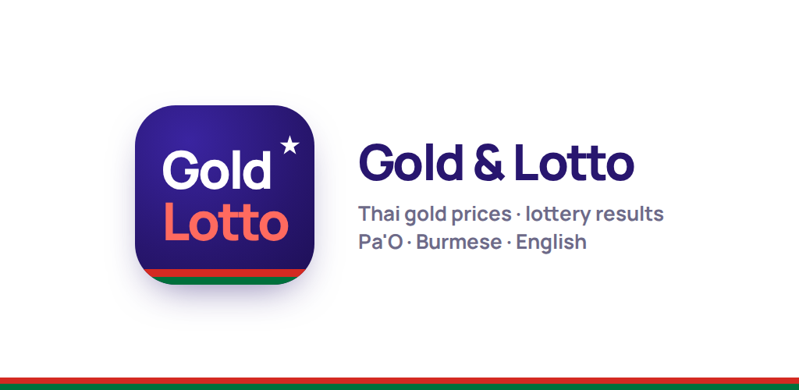
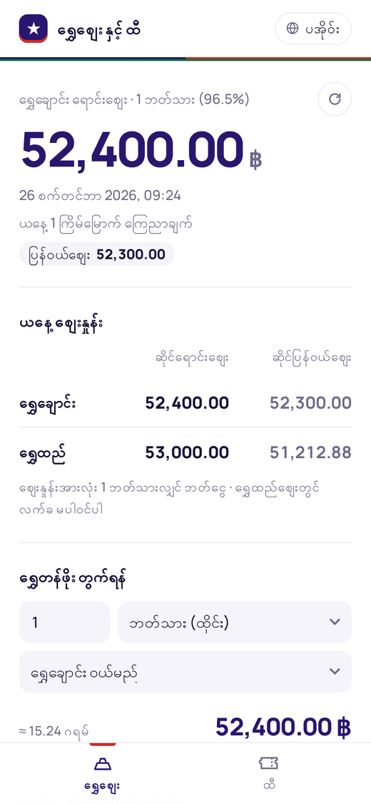
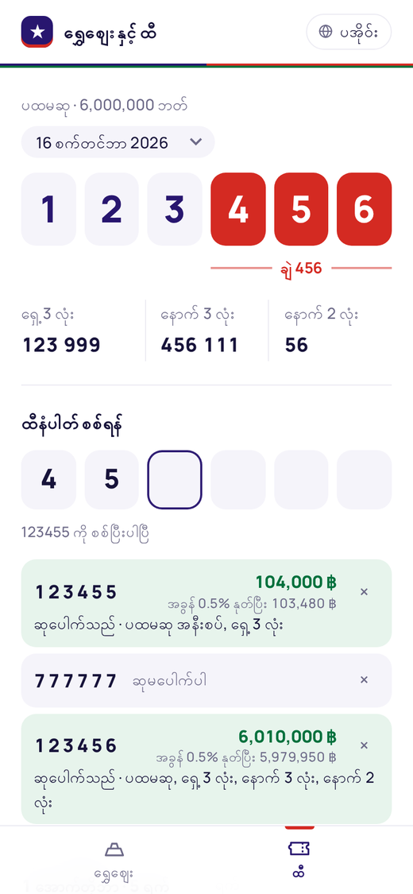
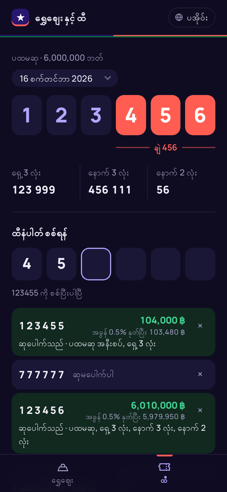

<p align="center"></p>

# Gold & Lotto

Thai gold prices and a Thai Government Lottery checker, in **Pa'O**, **Burmese** and **English**.
It runs as an Android app and as a website, from the same code.

<p align="center">
  
  
  
</p>

**Download the Android app:** see [Releases](../../releases/latest) and get the `.apk` file.

## Features

**Gold**
- Today's Gold Traders Association price for 96.5% gold: bars and jewelry, sell and buy-back
- Value calculator in baht-weight, salung, kyattha, pe or grams
- Refreshes every 5 minutes, and shows the last saved price when offline

**Lottery**
- First prize, with the last three digits marked **ချဲ**, plus front 3, back 3 and back 2
- Type a 6-digit ticket number and it checks every prize automatically, with the total after the 0.5% stamp duty
- Past draws for the last 2 years, next draw date, last day to claim
- Your checked numbers are remembered on the phone and re-checked when you change the draw

**Dream** (အိပ်မက်)
- 1,000 traditional dream symbols with hand-drawn illustrations, each linked to a lucky number
- Search bar is always visible at the top of the tab — no icon to tap first
- Filter by All / Animals / Objects / People, mark favorites (★), shown for cultural reference only

**Settings**
- Theme: Auto (follows the phone), Dark, or Light — overrides the system setting
- About app: version, developer credit, data-source credits, and a plain-language privacy note (nothing leaves your phone)

**Design**
- A clean, minimal layout in the colors of the Pa'O flag: navy with the white star, red and green
- Opens in Pa'O. Switch language with the button at the top right.
- Light and dark mode

## Project layout

```
www/                  the app itself (used by both Android and the website)
  index.html            page, styles, logic
  i18n.js               all texts: Pa'O, Burmese, English
  lotto.js              lottery results: fetching + parsing
  dream-data.js         the 1,000 dream symbols + numbers
  dream.js              dream tab: search, filter, favorites, remote/local image switch
  fonts/                bundled fonts (Manrope, Padauk)
dream-images/         1,000 illustrations, 000.png … 999.png — deliberately OUTSIDE www/,
                      see "Dream images & app size" below
api/                  website-only API routes (Vercel): /api/price, /api/lottery
android/              Android project (Capacitor)
assets/               icon + splash source images (run `npm run icons` after changing)
store/                Google Play icon, feature graphic, privacy policy
.github/workflows/    builds the APK and publishes a GitHub Release when you push a tag
publish.sh            first upload to GitHub
release.sh            publish a new version
```

## Dream images & app size

`dream-images/` is ~56 MB. It sits at the repo root, **not** inside `www/`, on purpose:
Capacitor's `webDir` is `www`, so `cap sync` only bundles what's in there — keeping it out
keeps the installed Android app ~56 MB smaller.

- **Website:** served directly from the repo root (Vercel does this automatically for any
  file outside `api/`; `server.js` does the same for `npm start`).
- **Android app:** loads the same images at runtime straight from this GitHub repo's raw
  content CDN, so it needs internet to show them (same as the Lottery tab already does).

Once you've pushed this repo to GitHub, open `www/dream.js` and set these three lines near
the top to your actual repo:
```js
const GITHUB_OWNER = "YOUR-GITHUB-USERNAME";
const GITHUB_REPO = "gold-lotto";
const GITHUB_BRANCH = "main";
```
Then `npx cap sync android` and rebuild. If you'd rather keep the Dream tab fully offline
on Android instead (larger app, no internet needed for it), move `dream-images/` into
`www/` and change `imgSrc()` in `dream.js` to always return the local path.

## Publish to GitHub (first time)

1. **Create an empty repository** on GitHub, named e.g. `gold-lotto` and set to **Public**.
   Don't add a README or license, so it stays empty.
2. **Add the signing secrets.** Open your repo → **Settings → Secrets and variables → Actions → New repository secret**
   and add the 4 values from `goldlotto-signing-secrets.txt`. That file is kept separate from this project; see [Signing](#signing).
3. **Upload the code.** In Terminal, in this folder:
   ```bash
   ./publish.sh https://github.com/YOUR-NAME/gold-lotto.git
   ```
4. **Release version 1.0.0:**
   ```bash
   ./release.sh 1.0.0
   ```
   GitHub builds the app in about 5–10 minutes. The APK then appears under **Releases**.

For later versions, change what you want and run `./release.sh 1.1.0` (then 1.2.0, and so on).

If `git push` asks you to log in, sign in with the GitHub CLI (`gh auth login`) or use a personal access token as the password.

## Install on a phone

Open the latest **Release** on the phone, download `GoldLotto-x.y.z.apk` and open it.
Allow "install unknown apps" for your browser when Android asks.
Updates install over the old version as long as they're signed with the same key.

## Signing

The APK is signed with your own key (`goldlotto-release.jks`, kept outside this repo). The 4 GitHub secrets are:

| Secret | Value |
|---|---|
| `ANDROID_KEYSTORE_BASE64` | the keystore file as base64 text (`goldlotto-keystore-base64.txt`) |
| `ANDROID_KEYSTORE_PASSWORD` | keystore password |
| `ANDROID_KEY_ALIAS` | `goldlotto` |
| `ANDROID_KEY_PASSWORD` | key password |

**Back up the `.jks` file and its password.** Every future update, on GitHub and on Google Play, must be signed with it.
If the secrets are missing, the workflow still builds, but it uses a temporary key and later versions won't install over that build.

To build locally with the key:
```bash
export ANDROID_KEYSTORE_PATH=/path/to/goldlotto-release.jks ANDROID_KEYSTORE_PASSWORD=… ANDROID_KEY_ALIAS=goldlotto ANDROID_KEY_PASSWORD=…
npm install && npx cap sync android && cd android && ./gradlew assembleRelease
```

## Run the website locally

Requires Node.js 18+. No install step is needed.
```bash
npm start      # → http://localhost:3000
```

## Deploy the website (Vercel)

Import the repo at [vercel.com](https://vercel.com) with the Framework Preset set to **Other**, and leave the build settings empty.
`vercel.json` serves `www/` and runs the `api/` routes in Vercel's Singapore region, which is closest to Thailand.

To check the deployment, open `https://YOUR-SITE.vercel.app/api/price` and `/api/lottery`. Each shows either the data or the exact reason it failed.

## Pa'O translation

Open `www/i18n.js`. The `blk` section at the top is Pa'O, and every line shows the Burmese and English meaning:
```js
tabGold: "",   // ရွှေဈေး  |  Gold
```
Type the Pa'O text between the quotes. Empty lines show Burmese, so the app always works while the translation is in progress.
Keep `{n}`, `{amt}` and `{name}` as they are, and keep numbers as English digits.

## Google Play

Each release also includes `GoldLotto-x.y.z.aab`, the file Google Play needs. Use `store/` for the icon, feature graphic and privacy policy.
New personal developer accounts must run a closed test with at least 12 testers for 14 days before publishing.
In the store listing, describe the app as checking *official* results. It doesn't sell tickets or take bets.

## Data sources

- Gold: [api.chnwt.dev/thai-gold-api](https://github.com/max180643/thai-gold-api), a community API reading goldtraders.or.th
- Lottery: the Government Lottery Office API (glo.or.th). The app asks GLO directly from the phone; the website asks through its `/api/lottery` route.

Prices and results are for reference only. Always confirm with the official announcement before claiming a prize.
This project isn't affiliated with the Gold Traders Association or the Government Lottery Office.
